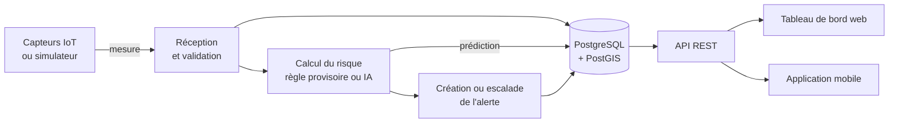

# HydrO'Alerte CI — Backend

API du prototype **HydrO'Alerte CI** : surveillance, prévision et alerte des inondations à Abidjan.
La zone pilote est Riviera 9 Kilos, à Cocody.

Ce dépôt contient uniquement le **backend** : API REST, base de données géographique, règles d'alerte et intégrations.
Les applications web et mobile, le matériel IoT et le modèle d'IA sont développés par les autres membres de l'équipe.
Ils utilisent cette API.

| | |
|---|---|
| API en ligne | https://hydroalert-api.onrender.com |
| Documentation interactive | https://hydroalert-api.onrender.com/docs |
| Documentation Word de l'API | [`docs/API_HydrOAlerte_CI_v0.3.1.docx`](docs/) (dernière version) |
| Branche de travail | `backend` |

> **Note.** Les données actuelles sont **fictives** : polygone approximatif de la zone, capteurs simulés.
> L'API gratuite se met en veille après 15 minutes sans requête ; la première requête suivante prend environ une minute.

---

## Sommaire

1. [Fonctionnement](#fonctionnement)
2. [Technologies](#technologies)
3. [Installation locale](#installation-locale)
4. [Variables d'environnement](#variables-denvironnement)
5. [Commandes](#commandes)
6. [Endpoints de l'API](#endpoints-de-lapi)
7. [Simulateur et import de zone](#simulateur-et-import-de-zone)
8. [Tests](#tests)
9. [Structure du projet](#structure-du-projet)
10. [Déploiement](#déploiement)
11. [Sécurité](#sécurité)
12. [Dépannage](#dépannage)
13. [État d'avancement et documentation](#état-davancement-et-documentation)

---

## Fonctionnement

Le backend relie les capteurs, le calcul du risque et les applications clientes :



1. Une **mesure** arrive (niveau d'eau, pluie, débit, batterie). Elle est validée puis enregistrée, sans doublon.
2. Le **risque de la zone** est calculé. Le score de 0 à 100 donne un niveau :

   | Score | Niveau | Couleur |
   |---|---|---|
   | 0–39 | NORMAL | vert |
   | 40–64 | VIGILANCE | orange |
   | 65–84 | DANGER | rouge |
   | 85–100 | EVACUATION | rouge |

3. Une **alerte** est créée à partir du niveau VIGILANCE, puis escaladée si le niveau monte. Il y a une seule alerte ouverte par zone.
4. Les applications consultent les zones, capteurs, mesures, prédictions et alertes **via l'API**, y compris au format GeoJSON pour la carte.

La règle de calcul et la politique d'alerte sont **provisoires**, en attendant les décisions de l'équipe et le service d'IA.
Elles sont détaillées dans [`docs/Regles_Metier_HydrOAlerte_CI.txt`](docs/Regles_Metier_HydrOAlerte_CI.txt), section 17.

---

## Technologies

- **Node.js 24**, **TypeScript**, **Fastify 5** (API REST)
- **PostgreSQL 16 + PostGIS 3.4** (zones, positions, distances en mètres)
- **Prisma 6** (schéma, migrations, accès aux données), avec du SQL brut pour les fonctions PostGIS
- **Zod** (validation des entrées et des réponses) et **Swagger / OpenAPI** (documentation générée)
- **pnpm** (gestionnaire de paquets), **Docker** (base locale)
- Hébergement : **Render** (API) et **Neon** (base PostgreSQL/PostGIS)

---

## Installation locale

### Prérequis

| Outil | Version | Vérifier |
|---|---|---|
| Node.js | 24 ou plus | `node --version` |
| pnpm | 11 | `pnpm --version` (sinon `npm install -g pnpm@11.15.1`) |
| Docker Desktop | récent, démarré | `docker compose version` |
| Git | — | `git --version` |

### Étapes (PowerShell ou terminal)

```powershell
# 1. Récupérer le code
git clone https://github.com/emmanuelndia/hydroalert-ci.git
cd hydroalert-ci
git checkout backend

# 2. Installer les dépendances
pnpm install

# 3. Créer la configuration locale (les valeurs par défaut conviennent au développement)
Copy-Item .env.example .env        # sous macOS/Linux : cp .env.example .env

# 4. Démarrer PostgreSQL/PostGIS (premier lancement : téléchargement de l'image)
docker compose up -d db
docker compose ps                  # attendre l'état "healthy"

# 5. Créer les tables et charger les données fictives
pnpm db:migrate:deploy
pnpm db:seed

# 6. Lancer l'API
pnpm dev
```

L'API répond alors sur http://127.0.0.1:3000. La documentation interactive est sur http://127.0.0.1:3000/docs.

Pour les **tests d'intégration**, créer une fois la base de test :

```powershell
docker compose exec db createdb -U hydroalert hydroalert_test
```

> **Important.** Dans `.env`, `DATABASE_URL` doit rester sur la **base locale** (`127.0.0.1:5432/hydroalert`).
> N'y mettez jamais la chaîne de connexion de production (Neon) : les commandes locales viseraient alors la base en ligne.

---

## Variables d'environnement

Toutes les variables sont décrites dans [`.env.example`](.env.example). Elles sont vérifiées au démarrage : une valeur invalide arrête le serveur avec un message clair.

| Variable | Défaut | Rôle |
|---|---|---|
| `DATABASE_URL` | — (obligatoire) | Base PostgreSQL/PostGIS |
| `TEST_DATABASE_URL` | — | Base distincte pour `pnpm test:integration` |
| `NODE_ENV` | `development` | `development`, `test` ou `production` |
| `PORT` / `HOST` | `3000` / `0.0.0.0` | Adresse d'écoute |
| `API_PUBLIC_URL` | `http://127.0.0.1:<PORT>` | Adresse publique, affichée dans Swagger et dans le `.docx` |
| `CORS_ORIGINS` | `*` (obligatoire en production) | Sites web autorisés à appeler l'API, séparés par des virgules |
| `RISK_EVALUATOR` | `rule` (`none` en production) | Calcul du risque après chaque mesure : règle provisoire ou désactivé |
| `RULE_CRITICAL_WATER_LEVEL_CM` | `100` | Niveau d'eau (cm) qui correspond à un score de 100 |
| `ALERT_VALIDATION_LEVELS` | vide | Niveaux d'alerte qui attendent une validation humaine |
| `TRUST_PROXY` | `false` (`true` sur Render) | Lire l'adresse du client derrière un proxy |
| `RATE_LIMIT_MAX` | `120` | Requêtes par minute et par IP (`0` = pas de limite) |
| `LOG_LEVEL` | `info` | Niveau de détail des journaux |

Dans `.env`, les commentaires commencent par `#`, jamais par `//`.

---

## Commandes

| Commande | Rôle |
|---|---|
| `pnpm dev` | Lance l'API en développement, avec rechargement automatique |
| `pnpm build` puis `pnpm start` | Compile dans `dist/` puis lance la version de production |
| `pnpm test` | Tests unitaires (sans base de données) |
| `pnpm test:integration` | Tests d'intégration sur `TEST_DATABASE_URL` (migration et données fictives automatiques) |
| `pnpm exec tsc --noEmit` | Vérification des types TypeScript |
| `pnpm db:migrate:deploy` | Applique les migrations en attente |
| `pnpm db:migrate:dev` | Crée une nouvelle migration après une modification de `prisma/schema.prisma` (base locale uniquement) |
| `pnpm db:migrate:status` | Indique les migrations appliquées ou en attente |
| `pnpm db:seed` | Charge les données fictives (sans doublon, peut être relancé) |
| `pnpm simulate` | Simule un capteur dont le niveau monte (voir plus bas) |
| `pnpm zone:import` | Importe ou remplace le polygone d'une zone depuis un fichier GeoJSON |
| `pnpm docs:api` | Génère la documentation Word de l'API dans `docs/` |

---

## Endpoints de l'API

Toutes les routes sont en **lecture seule** et **publiques** pour l'instant. L'authentification est prévue au lot 4.
Le détail des paramètres et des réponses se trouve dans Swagger (`/docs`) et dans le `.docx`.

| Route | Description |
|---|---|
| `GET /health/live` | Le processus API répond |
| `GET /health` | L'API et la base de données sont disponibles (503 sinon) |
| `GET /zones`, `GET /zones/{id}` | Zones (le détail inclut la géométrie GeoJSON) |
| `GET /sensors`, `GET /sensors/{id}` | Capteurs, avec latitude et longitude |
| `GET /sensors/{id}/measurements` | Historique des mesures (`from`, `to`) |
| `GET /predictions` | Historique des calculs de risque, avec couleur |
| `GET /alerts`, `GET /alerts/{id}` | Alertes |
| `GET /zones/geojson` | **Carte** : zones avec niveau de risque, alerte publiée et couleur |
| `GET /sensors/geojson` | **Carte** : capteurs avec leur dernière mesure |
| `GET /zones/locate?latitude=&longitude=` | Zones qui contiennent un point |
| `GET /sensors/nearby?latitude=&longitude=&radiusM=` | Capteurs dans un rayon en mètres |

**Conventions :**
- **JSON** en entrée et en sortie ; **dates ISO 8601** en UTC ; **coordonnées WGS 84**. En GeoJSON, l'ordre est `[longitude, latitude]`.
- **Pagination** des listes : `page` (défaut 1) et `pageSize` (défaut 20, maximum 100). Réponse `{ "data": [...], "pagination": { "page", "pageSize", "total" } }`.
- **Erreurs** au format unique `{ "error": { "code", "message", "details"? } }` :

  | Statut | Code | Signification |
  |---|---|---|
  | 400 | `VALIDATION_ERROR` | Paramètre invalide ; `details` indique les champs en cause |
  | 404 | `NOT_FOUND` | Ressource ou route introuvable |
  | 413 | `FST_ERR_CTP_BODY_TOO_LARGE` | Corps de requête supérieur à 100 Ko |
  | 429 | `RATE_LIMITED` | Trop de requêtes ; l'en-tête `Retry-After` indique quand réessayer |
  | 500 | `INTERNAL_ERROR` | Erreur interne, sans détail technique exposé |

---

## Simulateur et import de zone

### Simuler une montée des eaux

En attendant le contrat MQTT des capteurs, le simulateur fait passer des mesures par toute la chaîne : enregistrement, risque, alerte.

```powershell
pnpm simulate --sensor CAP-COC-01 --from 30 --to 110 --steps 8 --interval 2
pnpm simulate --sensor CAP-COC-03 --rain --from 0 --to 20 --steps 5     # pluviomètre
```

Chaque étape affiche le score, le niveau de risque et l'action sur l'alerte (création, escalade ou rien).

### Importer le polygone officiel d'une zone

```powershell
# Vérifier sans rien enregistrer
pnpm zone:import --file docs/zones/riviera-9-kilos.geojson --name "Riviera 9 Kilos" --dry-run
# Importer : remplace la géométrie de la zone du même nom et rattache les capteurs à leur zone
pnpm zone:import --file docs/zones/riviera-9-kilos.geojson --name "Riviera 9 Kilos"
```

- Le fichier peut contenir un `Polygon`, un `MultiPolygon`, une `Feature` ou une `FeatureCollection`.
- Sans fichier officiel, on peut dessiner le contour sur [geojson.io](https://geojson.io) puis faire « Save > GeoJSON ».
- Une géométrie invalide est refusée avec un message explicite, de même qu'une zone hors de Côte d'Ivoire (signe probable d'une latitude et d'une longitude inversées).

**Protection :** ces deux outils affichent la base visée au démarrage. Ils **refusent d'écrire sur une base distante** (par exemple Neon) sans l'option `--remote`.

---

## Tests

```powershell
pnpm test                 # tests unitaires : seuils de risque, validations, configuration, sécurité
pnpm test:integration     # tests sur une vraie base PostGIS : routes, chaîne mesure → alerte, requêtes géographiques
pnpm exec tsc --noEmit    # types
```

- Les tests d'intégration utilisent **uniquement** la base `TEST_DATABASE_URL`. Ils refusent de démarrer si elle est identique à `DATABASE_URL`.
- Ils appliquent les migrations, chargent les données fictives, puis suppriment les données qu'ils ont créées.

---

## Structure du projet

```
src/
  server.ts            démarrage, arrêt propre
  app.ts               construction de l'application Fastify (utilisée aussi par les tests)
  config.ts            lecture et validation des variables d'environnement
  domain/risk.ts       niveaux de risque, seuils, couleurs (fonctions pures)
  plugins/             base de données, erreurs, sécurité, CORS, Swagger
  routes/              définition des endpoints (santé, zones, capteurs, alertes, prédictions, cartographie)
  schemas/             schémas Zod des paramètres, mesures et réponses
  services/            logique métier : ingestion, calcul du risque, alertes, PostGIS, consultation
  lib/                 erreurs HTTP, journalisation sans secret
prisma/
  schema.prisma        modèle de données
  migrations/          migrations SQL (PostGIS, contraintes, index spatiaux)
  seed.ts              données fictives
scripts/               simulateur, import de zone, tests d'intégration, génération du .docx
tests/integration/     tests sur base réelle
docs/                  documents du projet, règles métier, roadmap, guides, documentation de l'API
render.yaml            configuration du déploiement Render
docker-compose.yml     PostgreSQL/PostGIS local
```

---

## Déploiement

L'API est hébergée sur **Render**, offre gratuite, et la base sur **Neon** (PostgreSQL + PostGIS, offre gratuite).

- Chaque `git push` sur la branche `backend` **redéploie automatiquement** l'API.
- Les migrations en attente sont **appliquées au démarrage** (`npm run start:render`).
- Les secrets (`DATABASE_URL`, etc.) sont saisis dans le tableau de bord Render, **jamais** dans le dépôt.

Le guide pas à pas est dans [`docs/Deploiement_HydrOAlerte_CI.txt`](docs/Deploiement_HydrOAlerte_CI.txt) : création de la base Neon, configuration Render, chargement des données et vérifications.

---

## Sécurité

- Toutes les entrées sont validées (Zod) ; les réponses ne contiennent jamais d'empreinte de clé ni de secret.
- Les requêtes sont limitées à 120 par minute et par adresse IP. Les corps de requête sont limités à 100 Ko et le traitement à 30 secondes.
- Des en-têtes de sécurité HTTP sont ajoutés (helmet) ; CORS est configurable et une liste explicite est obligatoire en production.
- Les journaux ne contiennent ni en-têtes d'authentification ni cookies ; les paramètres d'URL sensibles (`token`, `api_key`, `password`…) sont masqués.
- `.env` est ignoré par Git. **Ne jamais committer ni partager** une chaîne de connexion, un mot de passe ou un jeton.

**Limite actuelle :** il n'y a pas encore d'authentification (lot 4), donc aucune route ne permet de modifier des données.

---

## Dépannage

| Problème | Cause probable et solution |
|---|---|
| `P1001: Can't reach database server` | Docker Desktop est arrêté ou la base n'est pas « healthy » : lancer `docker compose up -d db` puis `docker compose ps`. Utiliser `127.0.0.1` et non `localhost` dans `DATABASE_URL` (sous Windows, `localhost` passe par IPv6). |
| `docker compose` signale une erreur dans `.env` | Une ligne de `.env` n'est pas au format `NOM=valeur` ; les commentaires commencent par `#`. |
| `EADDRINUSE ... :3000` | Une autre instance de l'API tourne déjà : la fermer, ou définir un autre `PORT`. |
| `Configuration invalide : ...` au démarrage | Une variable de `.env` est incorrecte : le message indique laquelle. |
| `CORS_ORIGINS est obligatoire en production` | Définir `CORS_ORIGINS` dans Render. |
| Un site web reçoit une erreur CORS | Ajouter l'adresse du site (ex. `http://localhost:5173`) à `CORS_ORIGINS`. |
| L'émulateur Android n'atteint pas l'API locale | Utiliser `http://10.0.2.2:3000` au lieu de `127.0.0.1`. |
| La première requête à l'API en ligne est lente | L'API Render gratuite sortait de veille (environ 1 minute). |
| `429 RATE_LIMITED` | Trop de requêtes en une minute : attendre le délai indiqué par `Retry-After`. |

---

## État d'avancement et documentation

**Réalisé :**
- API de consultation ;
- chaîne mesure → prédiction → alerte, avec simulateur ;
- cartographie PostGIS et GeoJSON ;
- protection de l'API ;
- déploiement Render + Neon.

**En attente de l'équipe :**

| Sujet | Dépend de |
|---|---|
| Format MQTT des capteurs et coordonnées réelles | Responsable IoT |
| Service d'IA | Responsables IA |
| Polygone officiel de la zone | Équipe |
| Rôles et mode de connexion (lot 4) | Équipe |
| Niveaux d'alerte à valider | Équipe |
| Notifications Firebase (lot 8) | Équipe et responsable mobile |

| Document | Contenu |
|---|---|
| [`docs/Roadmap_Backend_HydrOAlerte_CI.txt`](docs/Roadmap_Backend_HydrOAlerte_CI.txt) | Lots de travail et avancement |
| [`docs/Taches_Utilisateur_HydrOAlerte_CI.txt`](docs/Taches_Utilisateur_HydrOAlerte_CI.txt) | Actions à mener et décisions à obtenir |
| [`docs/Regles_Metier_HydrOAlerte_CI.txt`](docs/Regles_Metier_HydrOAlerte_CI.txt) | Règles métier, dont les règles provisoires (section 17) |
| [`docs/Modele_Donnees_HydrOAlerte_CI.txt`](docs/Modele_Donnees_HydrOAlerte_CI.txt) | Modèle de données cible |
| [`docs/Choix_Techniques_HydrOAlerte_CI.txt`](docs/Choix_Techniques_HydrOAlerte_CI.txt) | Choix techniques et état du dépôt |
| [`docs/Deploiement_HydrOAlerte_CI.txt`](docs/Deploiement_HydrOAlerte_CI.txt) | Guide de déploiement |
| `docs/API_HydrOAlerte_CI_v*.docx` | Documentation de l'API pour les équipes web, mobile et IA |
